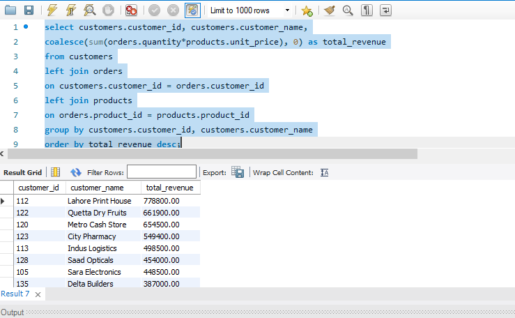
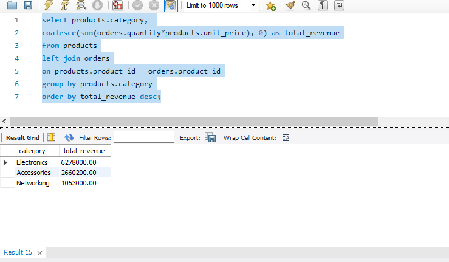
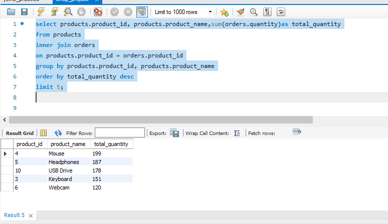
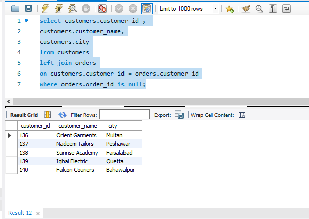
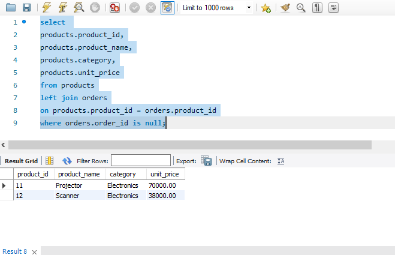
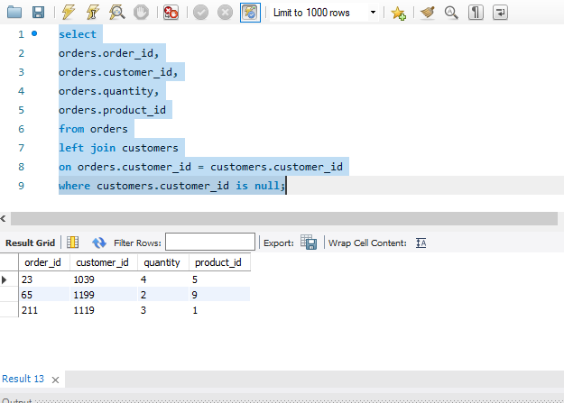
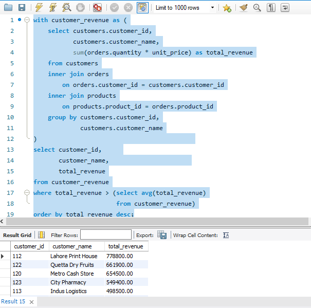
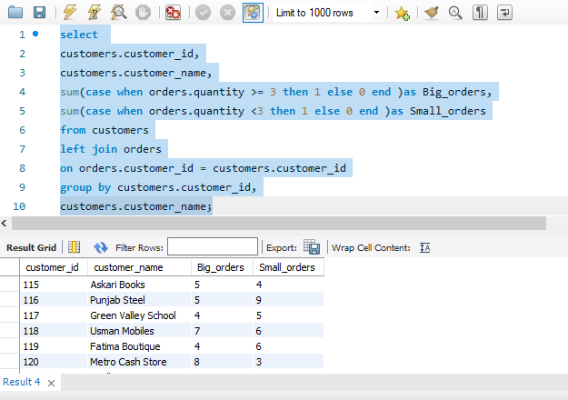
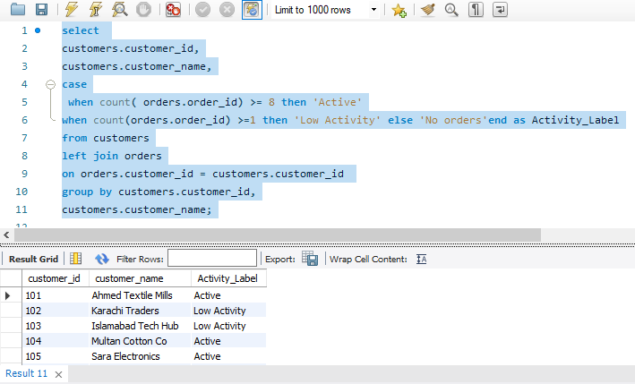
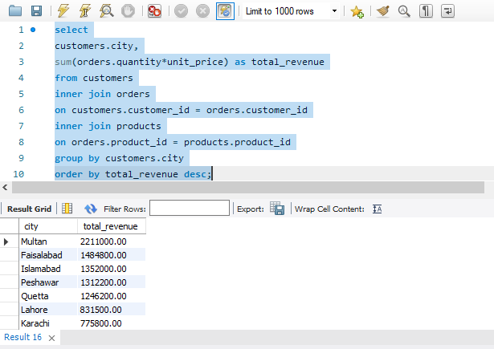

# SQL Business Analysis: Shop Sales

10 business questions answered with SQL (MySQL) on a small shop database, each with the query, a result screenshot and an insight.

## Dataset
Database `shop_project` with 3 tables: customers (40), products (12) and orders (300, Jan to Oct 2026). It is practice data, not real business data. It includes deliberate data problems: 5 customers with no orders, 2 products that never sold, and 3 orders from customers missing in the customers table.

## Skills used
INNER and LEFT JOINs, GROUP BY, aggregates, CASE, COALESCE, subqueries and CTEs.

## Key findings
- Revenue from known customers is 9,713,200. The top 10 customers bring in about 53% of it.
- Electronics earns about 63% of revenue, while Accessories make up the top 5 products by units sold.
- Multan is the top city at 2,211,000.
- 3 orders (278,000) belong to customers missing from the customers table.

## How I used AI
I used an AI mentor for hints and reviews. For each question I wrote my plan and predicted the number of rows before running the query, and I checked totals against each other (for example, the city totals add up to the customer total).

## How to run
1. Run `shop_project.sql` in MySQL Workbench to create and fill the database.
2. Run the queries from `queries.sql`.

Tools: MySQL, MySQL Workbench.

---

## Q1. How much has each customer spent in total?

Query: see queries.sql (Q1)

Result: 

Insight: Total revenue is 9,713,200 across 35 paying customers. The top 5 customers bring in about 32% of it, and the top 10 bring in about 53%, so revenue depends on a small group of buyers. Lahore Print House is the largest at 778,800 (8% of the total). 5 customers have never ordered and bring in 0.

## Q2. Which category earns the most revenue?

Query: see queries.sql (Q2)

Result: 

Insight: Electronics brings in 6,278,000, about 63% of total revenue (9,991,200). Accessories is second at 26.6% and Networking third at 10.5%. Electronics leads because its items are far more expensive, even though 2 of its 6 products (Projector and Scanner) never sold. Networking has only one product, the Router. Note: this total is 278,000 higher than Q1 because it includes 3 orders from customers missing in the customers table.

## Q3. Which are the top 5 products by quantity sold?

Query: see queries.sql (Q3)

Result: 

Insight: The top 5 products by units sold are all in the Accessories category. The Mouse leads with 199 units, followed by Headphones (187), USB Drive (178), Keyboard (151) and Webcam (120). Together these 5 products account for 835 of the 1,088 units sold, about 77%. Compared with Q2, where Electronics earned the most revenue, none of the top 5 sellers by quantity are Electronics. Accessories sell in high volume at low prices, while Electronics sell in lower volume at high prices.

## Q4. Which customers have never placed an order?

Query: see queries.sql (Q4)

Result: 

Insight: 5 of the 40 customers (12.5%) have never placed an order: Orient Garments (Multan), Nadeem Tailors (Peshawar), Sunrise Academy (Faisalabad), Iqbal Electric (Quetta) and Falcon Couriers (Bahawalpur). Each is in a different city, so the problem is not tied to one region. These are registered customers who could be converted with a targeted offer or a follow-up call. The data does not show why they have not ordered, so the first step would be to ask them.

## Q5. Which products have never sold?

Query: see queries.sql (Q5)

Result: 

Insight: 2 of the 12 products have never sold: Projector (70,000) and Scanner (38,000). Both are in the Electronics category and are among the most expensive products, ranked 2nd and 5th by price. High price may be the reason, but the data does not prove it. The owner should check whether these items are in stock and on display, or consider removing them from the catalogue.

## Q6. Which orders belong to customers missing from the customers table?

Query: see queries.sql (Q6)

Result: 

Insight: 3 orders (order ids 23, 65 and 211) refer to customer ids that do not exist in the customers table: 1039, 1199 and 1119. Together they are worth 278,000 in revenue. This is why the total in Q2 (9,991,200) is higher than the total in Q1 (9,713,200): Q1 starts from the customers table, so these orders are left out. The owner should check whether these customers were never registered or the ids were entered by mistake, and add or correct the records.

## Q7. Which customers spent more than the average customer?

Query: see queries.sql (Q7)

Result: 

Insight: The average revenue per ordering customer is 277,520 (9,713,200 across 35 customers). 15 of the 35 customers are above this average, and together they bring in 6,656,200, about 69% of all customer revenue. The highest, Lahore Print House at 778,800, is nearly 3 times the average. Revenue is concentrated in a minority of strong customers, so keeping these accounts happy matters most. Customers who never ordered are not counted in the average.

## Q8. For each customer, how many Big and Small orders do they have?

Query: see queries.sql (Q8)

Result: 

Insight: A Big order is 3 or more units in a single order, and a Small order is below 3. Across the 297 orders from known customers, 146 are Big and 151 are Small, an almost even split. Sara Electronics and Metro Cash Store have the most Big orders (8 each). Royal Furnishers has no Big orders at all (5 Small), while Ali Photostat, Pak Fertilizers and Delta Builders have no Small orders. The 5 customers with no orders show 0 in both columns.

## Q9. How active is each customer?

Query: see queries.sql (Q9)

Result: 

Insight: Customers are labelled by number of orders: Active (8 or more), Low Activity (1 to 7) and No orders. Of the 40 customers, 20 are Active, 15 are Low Activity and 5 have never ordered. Among customers who have ordered, about 57% are Active. The 15 Low Activity customers are the best group to target with offers, because they already buy but order rarely. The thresholds are a business choice and can be changed.

## Q10. Which city brings in the most revenue?

Query: see queries.sql (Q10)

Result: 

Insight: Multan brings in the most revenue at 2,211,000 (about 23% of the total 9,713,200), followed by Faisalabad (1,484,800) and Islamabad (1,352,000). These top 3 cities together make up about 52% of revenue. Bahawalpur is the lowest at 499,700, more than 4 times smaller than Multan. Every city has 5 customers, so the differences come from how much each customer spends, not from the number of customers. Multan's lead depends on a few large accounts, including Lahore Print House, the biggest customer overall at 778,800. Revenue from the 3 orders with missing customers (278,000) is not included, because they have no city.